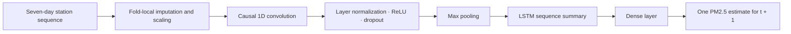
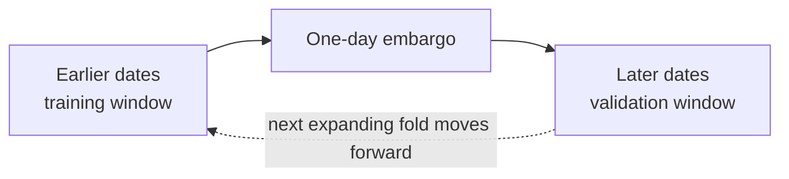

<div align="center">

# 🌫️ PM2.5 Forecasting with CNN–LSTM

### A reproducible, time-aware air-quality forecasting research project

**Group 16** · Daily station-level forecasts · One-day-ahead horizon

[](pyproject.toml)
[](configs/project.yaml)
[](src/pm25_project/splits.py)
[](data/manifest.yaml)

**The goal:** use recent PM2.5 history to estimate the next day’s concentration at a monitoring station, and evaluate that estimate without letting future information leak into training.

</div>

> [!IMPORTANT]
> This is a research and coursework project, **not an operational air-quality warning system**. The project records unresolved source-data licensing and provenance questions, and the saved historical future-test score is not a fresh, reproducible evaluation. Read [Limitations and responsible use](#-limitations-and-responsible-use) before interpreting or redistributing the data or results.

## 🧭 Start here

New to the project? This order will help:

1. Read [What the project does](#-what-the-project-does) and [How a forecast is made](#-how-a-forecast-is-made).
2. Follow [Quick start on Windows](#-quick-start-on-windows) to install the environment.
3. Run [the safe development workflow](#-safe-development-workflow) one step at a time.
4. See [Understanding the results](#-understanding-the-results) and then open the [final report](reports/final_report.pdf) or [final presentation](presentation/final_presentation_submission.pptx).

## 🌍 What the project does

PM2.5 is particulate matter with an aerodynamic diameter of 2.5 micrometres or smaller. This project studies whether the recent daily history at a monitoring station can help forecast that station’s PM2.5 concentration one day ahead.

| At a glance | Project setting |
|---|---|
| Prediction target | Daily PM2.5 concentration |
| Target unit | µg/m³ (micrograms per cubic metre) |
| Forecast origin | End of day *t* |
| Main forecast | PM2.5 on day *t + 1* |
| Input history | Seven consecutive daily steps in the configured CNN–LSTM setup |
| Main learned model | CNN–LSTM |
| Main validation | Five expanding temporal folds with a one-day embargo |
| Random seed | 42 |
| Main data source | [Air Quality – Mediterranean Basin (2016–2026)](https://www.kaggle.com/datasets/sarahameziane/air-quality-mediterranean-basin-20162026) |

The configured source CSV contains **41,718 rows**. The recorded cleaning audit retains **40,983 observations across 95 station identities**, spanning **2016-11-25 to 2026-04-06 (UTC)**. A station identity is formed from the sensor name and rounded latitude/longitude so that nearby sites are not automatically merged. See [`data/processed/audit.json`](data/processed/audit.json) and [`data/manifest.yaml`](data/manifest.yaml) for source and cleaning details.

## 🔭 How a forecast is made

At the end of day *t*, the model receives information from that station’s preceding seven-day sequence and outputs a numeric estimate for day *t + 1*:

```text
Past station history (7 daily steps)                  Forecast
┌───────────────────────────────────────────┐        ┌─────────────────┐
│ PM2.5 lags + past rolling values          │ ─────▶ │ PM2.5 at t + 1  │
│ Calendar cycles (day/week and day/year)   │        │     in µg/m³    │
└───────────────────────────────────────────┘        └─────────────────┘
                      Forecast made at the end of day t
```

In the configured experiment, the usable model inputs are calendar features, past PM2.5 values, and rolling summaries of past PM2.5. The source also contains meteorological and satellite-derived variables, but their delivery/availability time has not been verified. **Those environmental predictors are therefore not silently treated as known at forecast time.** Feature configuration lives in [`configs/project.yaml`](configs/project.yaml).

### 🧠 Model architecture

The main network combines a convolutional layer, which can learn short local patterns, with a recurrent LSTM layer, which can summarize sequence order:



The default network uses a causal `Conv1D`, layer normalization, ReLU activation, dropout, max pooling, an LSTM, a dense ReLU layer, and a single-value output. It is trained with Adam and mean squared error (MSE); early stopping monitors a chronological inner validation segment. The preprocessing pipeline is fitted on each training fold only, then applied to its validation fold. See [`src/pm25_project/models/cnn_lstm.py`](src/pm25_project/models/cnn_lstm.py) and [`src/pm25_project/preprocessing.py`](src/pm25_project/preprocessing.py).

### 🛡️ Why time-aware validation matters

With time-series data, a random split can let a model learn from dates that occur after the dates it is asked to predict. This project instead evaluates on later time periods and separates training from validation with an embargo:



The temporal folds are the primary development evidence. Separate station-grouped folds explore performance on held-out station groups; they answer a different question from forecasting later dates at known stations. Results from standard/randomized folds are diagnostic only and are not the primary basis for model selection. Fold definitions and their purpose are saved in [`results/16/folds_temporal.json`](results/16/folds_temporal.json) and [`results/16/folds_spatial.json`](results/16/folds_spatial.json).

## 📏 How to read the evaluation

The project reports metrics on the original PM2.5 scale:

| Metric | Plain-language meaning | Better value |
|---|---|---|
| **RMSE** | Typical error with extra penalty for large misses | Lower |
| **MAE** | Average absolute difference between forecast and observation | Lower |
| **R²** | How much variation is explained relative to a simple mean reference | Higher |

MAPE (percentage error) is not used because values close to zero can make it unstable. A forecast should also be compared with simple baselines such as persistence (reuse the latest observed PM2.5) and a seasonal-naive forecast; a neural network is not automatically useful just because it is more complex.

> [!CAUTION]
> The saved historical future-test metrics are **frozen legacy evidence**, not a score to reproduce by rerunning the evaluator. The recorded values are RMSE **6.0272 µg/m³**, MAE **4.0240 µg/m³**, and R² **0.2394** over **1,716 saved predictions**. The historical checkpoint/configuration needed to reproduce that evaluation is unavailable, and a recorded date-alignment gap remains unresolved. Do not use this score to tune models or claim a verified improvement over persistence. See [`results/16/future_test_evaluation.json`](results/16/future_test_evaluation.json) and the [final report](reports/final_report.pdf) for context.

## 💻 Quick start on Windows

The commands below use **PowerShell**. Python 3.12 (64-bit) is the recorded environment; the package metadata allows Python 3.11 and 3.12.

### 1. Open the project folder

Open PowerShell in the folder containing this README, or navigate to it:

```powershell
cd "C:\path\to\PM25_CNN_LSTM_Submission_Group16"
```

### 2. Create and activate a virtual environment

A virtual environment keeps this project’s Python packages separate from other projects on your computer.

```powershell
py -3.12 -m venv .venv
.\.venv\Scripts\Activate.ps1
```

If PowerShell blocks activation, allow it for **this PowerShell process only**, then activate:

```powershell
Set-ExecutionPolicy -Scope Process -ExecutionPolicy Bypass
.\.venv\Scripts\Activate.ps1
```

### 3. Install the project and its recorded dependencies

```powershell
python -m pip install --upgrade pip
python -m pip install -r requirements.txt
python -m pip install -e .
```

The dependency file includes TensorFlow and analysis, reporting, and testing packages, so installation may take a few minutes. The editable install makes the `pm25_project` package available to Python while you work in this folder.

### 4. Check the configuration

```powershell
python -m pm25_project.cli validate-config --config configs/project.yaml
```

You should see `Configuration valid`. The project config expects the source CSV at `data/raw/extracted/combined_gee_pm25.csv`. If the file is absent in your copy, obtain it from the [dataset page](https://www.kaggle.com/datasets/sarahameziane/air-quality-mediterranean-basin-20162026), review its usage terms, and place the CSV at the configured path. There is no automatic data download in this project.

## ▶️ Safe development workflow

Run these commands **in order** from the project root. Each command uses the same explicit configuration:

```powershell
# 1. Read, validate, and clean the configured source data.
python -m pm25_project.cli audit --config configs/project.yaml

# 2. Create exploratory summaries and plots.
python -m pm25_project.cli eda --config configs/project.yaml

# 3. Create or inspect the time-aware development fold definitions.
python -m pm25_project.cli folds --config configs/project.yaml

# 4. Score simple baselines on the defined folds.
python -m pm25_project.cli baselines --config configs/project.yaml

# 5. Run the primary CNN–LSTM temporal development experiment.
python -m pm25_project.cli cnn-lstm --config configs/project.yaml
```

The `audit` step creates the cleaned daily file under `data/processed/`. The later commands use that file. EDA, fold creation, baseline scoring, and model training can take longer depending on the computer; CNN–LSTM training requires the TensorFlow dependency.

### Optional development analyses

After the primary workflow, these commands run additional **development** analyses:

```powershell
# Evaluate the CNN–LSTM on station-grouped folds.
python -m pm25_project.cli cnn-lstm-spatial --config configs/project.yaml

# Examine variation across random seeds.
python -m pm25_project.cli cnn-lstm-seeds --config configs/project.yaml

# Explore selected CNN–LSTM hyperparameter sensitivity.
python -m pm25_project.cli cnn-sensitivity --config configs/project.yaml

# Compare configured feature ablations.
python -m pm25_project.cli cnn-feature-ablation --config configs/project.yaml

# Examine sensitivity to training-set size.
python -m pm25_project.cli cnn-train-size --config configs/project.yaml

# Build development-only comparison/report assets.
python -m pm25_project.cli cnn-lstm-finalize-dev --config configs/project.yaml
python -m pm25_project.cli report-assets --config configs/project.yaml
```

Use the experiment scripts at the repository root for the additional studies represented in the results archive. For example, `python run_optuna_development.py` launches a nested development-only hyperparameter search. Check a script’s source before changing its settings or starting a long run.

### ✅ Run the safe test suite

```powershell
python -m pytest -q --ignore=tests/test_final_evaluation.py
```

The one excluded test module exercises the single-use future evaluator. Do not run that evaluator as part of routine setup or development.

## 📦 Where things live

| Path | What you will find there |
|---|---|
| [`src/pm25_project/`](src/pm25_project/) | Python package: data audit, feature construction, sequence generation, splits, models, training, metrics, and diagnostics |
| [`src/pm25_project/models/`](src/pm25_project/models/) | CNN–LSTM implementation and model registry |
| [`configs/`](configs/) | Project/data settings, feature families, and model search spaces |
| [`data/raw/`](data/raw/) | Locally held source files; check the data license before sharing |
| [`data/processed/`](data/processed/) | Cleaned data and source/cleaning audit artifacts |
| [`data/manifest.yaml`](data/manifest.yaml) | Dataset origin, recorded checksums, and license caveat |
| [`results/16/`](results/16/) | Saved development results, predictions, folds, tables, figures, and frozen historical evidence |
| [`results/16/figures/`](results/16/figures/) | Exploratory, diagnostic, and validation charts |
| [`results/16/predictions/`](results/16/predictions/) | Saved out-of-fold and historical prediction files |
| [`reports/final_report.pdf`](reports/final_report.pdf) | Final written project report |
| [`presentation/final_presentation_submission.pptx`](presentation/final_presentation_submission.pptx) | Final project presentation |
| [`reproducibility/`](reproducibility/) | Validation records and integrity checks for saved artifacts |
| [`tests/`](tests/) | Automated checks for preprocessing, data contracts, splits, leakage, metrics, and models |

## 📚 Key artifacts and further reading

- **Project configuration:** [`configs/project.yaml`](configs/project.yaml)
- **Data provenance and licensing notes:** [`data/manifest.yaml`](data/manifest.yaml)
- **Cleaning audit:** [`data/processed/audit.json`](data/processed/audit.json)
- **Temporal out-of-fold results:** [`results/16/temporal_cv_results.csv`](results/16/temporal_cv_results.csv)
- **Development summary:** [`results/16/development_cv_summary.csv`](results/16/development_cv_summary.csv)
- **Model comparisons:** [`results/16/comparisons.csv`](results/16/comparisons.csv)
- **Saved final report:** [`reports/final_report.pdf`](reports/final_report.pdf)
- **Saved final presentation:** [`presentation/final_presentation_submission.pptx`](presentation/final_presentation_submission.pptx)

## ⚠️ Limitations and responsible use

1. **Dataset rights:** Kaggle labels the compiled dataset license “Other (specified in description).” Its description refers to OpenAQ, Copernicus, and NASA data, but the compiled bundle’s redistribution rights are not clear. The project’s manifest recommends local academic analysis until source-by-source attribution and redistribution rights are confirmed. Do not assume that including a file in this repository grants permission to redistribute it.
2. **Data provenance:** The provided combined CSV does not include a complete transformation log establishing exactly how its upstream feature join was performed.
3. **Predictor availability:** Delivery latency for exogenous environmental measurements has not been established. Current configured prediction features therefore avoid treating these values as if they were known at the forecast origin.
4. **Predictive evidence:** The available evidence describes modest predictive skill and does not establish a statistically significant improvement over persistence. Development-fold results are not guarantees of future performance.
5. **Historical holdout:** The saved future-test result is frozen historical evidence. Its original checkpoint/configuration is not available for a fresh evaluation, and recorded alignment limitations should be disclosed.
6. **Not operational advice:** Predictions are research outputs, not regulatory measurements, exposure advice, or a substitute for official air-quality monitoring.

For integrity and leakage reasons, do not use future-test labels to select features, tune hyperparameters, or compare new models. The configuration marks finalization as locked; use the development folds for new experiments.

## 🧰 Troubleshooting

| Problem | What to check |
|---|---|
| `No module named pm25_project` | Activate `.venv`, confirm you are in the repository root, and rerun `python -m pip install -e .`. |
| Missing source CSV / cleaned data | Confirm the configured raw CSV exists. Run `audit` before `eda`, `folds`, or model commands. |
| TensorFlow is unavailable | Activate the intended environment and install dependencies with `python -m pip install -r requirements.txt`. |
| Configuration validation fails | Check the data path, date and target columns, target units, and station identity settings in [`configs/project.yaml`](configs/project.yaml). |
| PowerShell refuses to activate `.venv` | Use the process-scoped execution-policy command in [Quick start](#-quick-start-on-windows); avoid changing the machine-wide policy for this project. |

## 🙌 Acknowledgements

The source dataset is attributed to Sarah Ameziane on Kaggle and the providers identified in the dataset description, including OpenAQ, Copernicus, and NASA. See the [dataset page](https://www.kaggle.com/datasets/sarahameziane/air-quality-mediterranean-basin-20162026) and [`data/manifest.yaml`](data/manifest.yaml); confirm the applicable terms for each source before reuse or redistribution.
